Aegis was SOAR's Team 707 hybrid rocket, built as a test bed for a future 100,000 ft hybrid and aimed at 10,000 ft. Its livery was a last-minute assignment, but it mattered a lot to me that we showed up with a good-looking rocket. This is how a quick design went from a vector in Figma, through some rough prototypes in Blender, to decals going on at competition.

## The idea: a wreath

The design was inspired by the wreaths of classical mythology: gold leaves winding up a white body, around the **AEGIS** wordmark and the team motto *Principia Vincunt Omnia* (roughly "principles conquer all"). Around that sit the Alberta coat of arms, the SOAR and University of Calgary marks, a gold maple-leaf nose cone and a column of sponsor logos.

My original plan was more ambitious. I wanted to lay the wreath pattern out and paint over it, so the composite body tubes would show through the design. With last-minute constraints, the paint shop only had time for one solid base coat, so the wreath went on as decals over white instead. Something to keep in mind for future designs.

## 1. Figma: the rocket, unrolled

A decal for a tube is a flat rectangle: one side is the tube's circumference, the other is the length of that section. So in Figma every section of the airframe became its own panel, sized to the real part: fin can, lower plumbing, pressure vessel, air brakes, avionics bay, recovery and nose cone.

 to nose cone (right)")

The wreath itself is simple. It's one vector, with some careful shading in Figma to give the gold a soft glow. I then duplicated that same design across the panels and edited each copy by hand, so the vines blend from one section into the next and the whole thing has a bit more character than a repeated pattern.

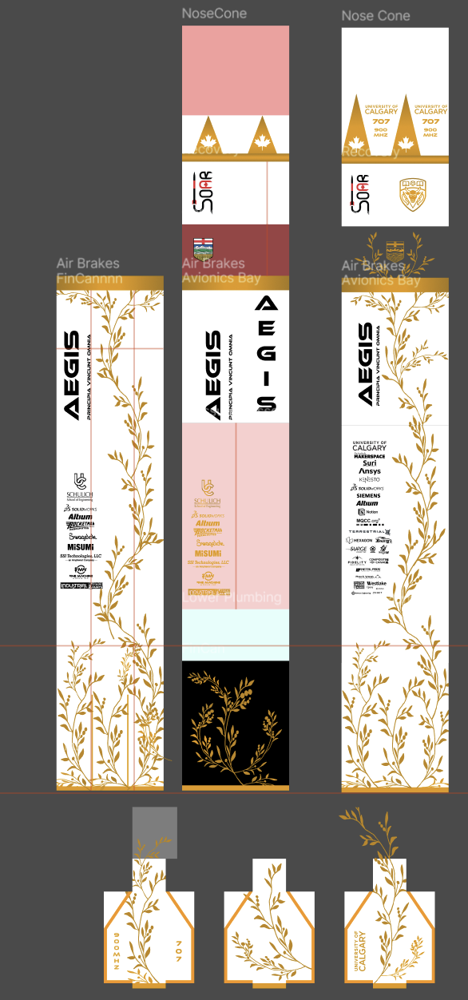

The Figma file became a running board for everything visual on Aegis: livery versions, rocket renders and several rounds of the team poster.

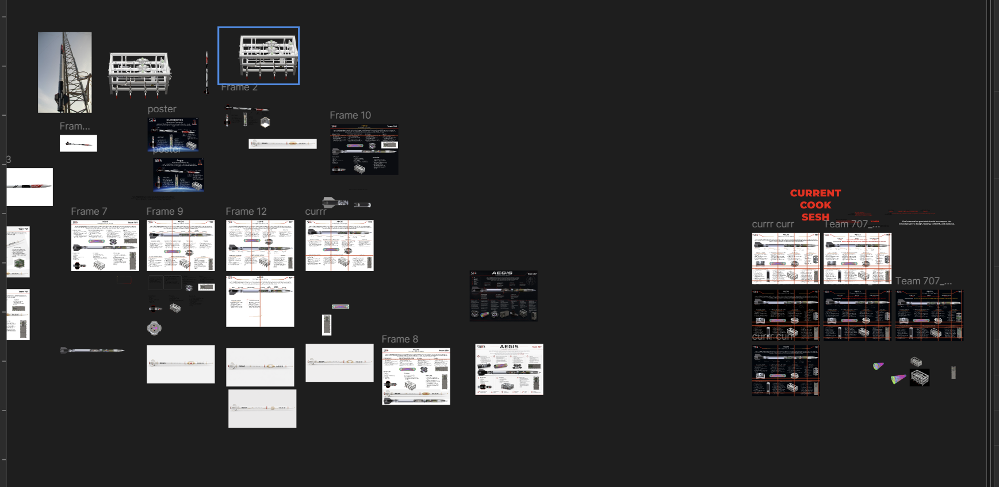

## 2. Blender: rough prototypes

The Blender prototypes were rough, and harder than they should have been. The rocket model came over from SolidWorks as a STEP file, and the mesh it generated broke every surface into long, thin triangles. Mapping a flat decal onto a tube means laying the tube's surface out flat in Blender's UV editor, and with that mesh the "unrolled" surface was a mess of slivers that didn't line up with the artwork.

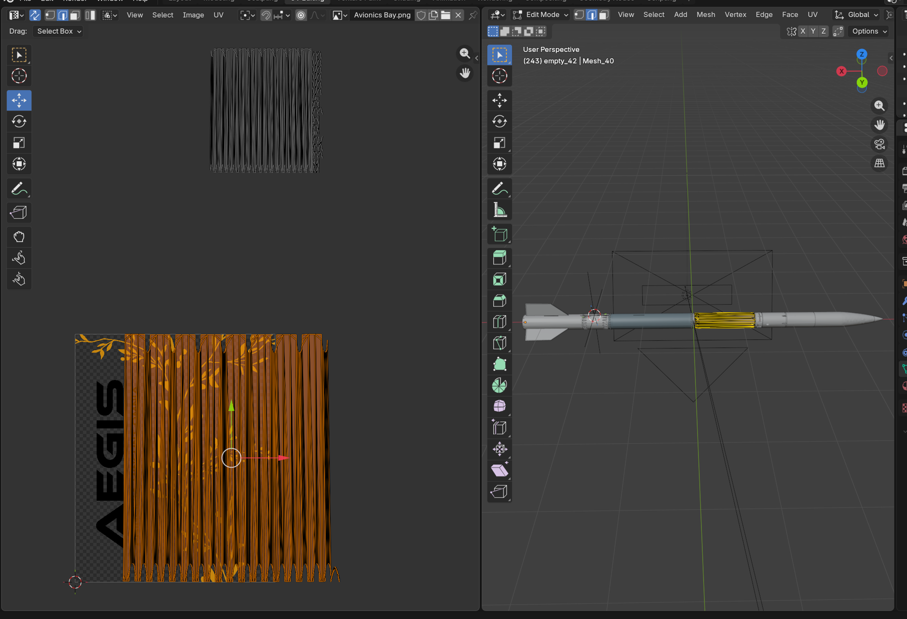

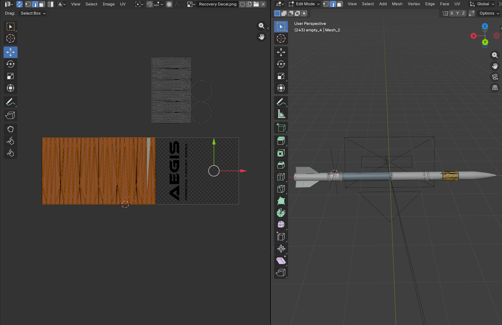

In comparison, SolidWorks, which I used to render with, can wrap a picture straight onto a surface like a tube. In Blender each section had to be coaxed into place by hand.

Even rough, the renders were worth it. They showed the plan and the reality side by side: the raw composite look I'd hoped to keep under the wreath, the white base coat we actually got, and the decals on top.

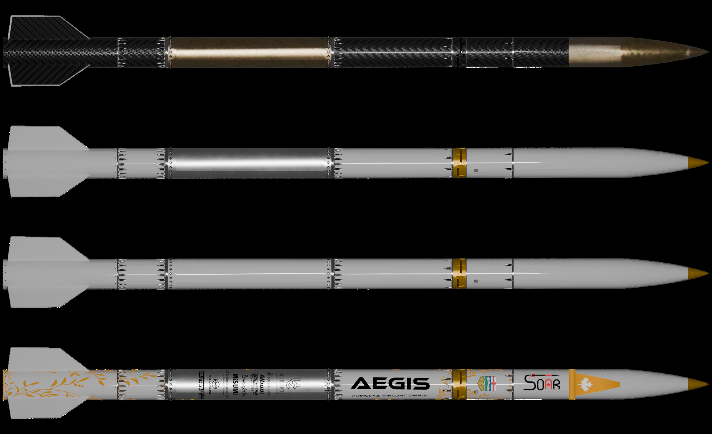

The first full set of decals, from both sides:

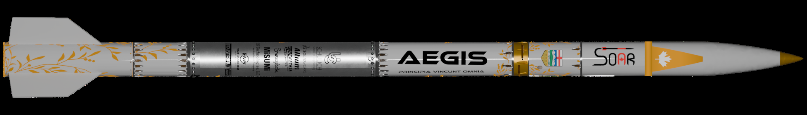

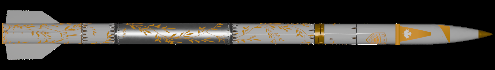

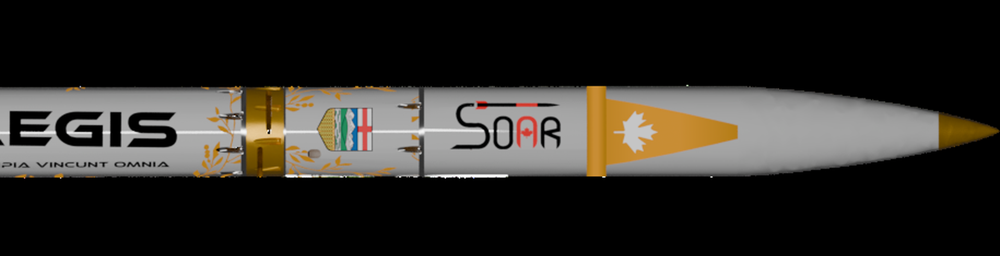

## 3. Real life

### Applying the decals

From here my friend and team captain, Andrew, took over the decals. With his work and the whole team's help, they went on while we were at competition, with the rocket laid across a hotel desk and every flat surface covered in tools.

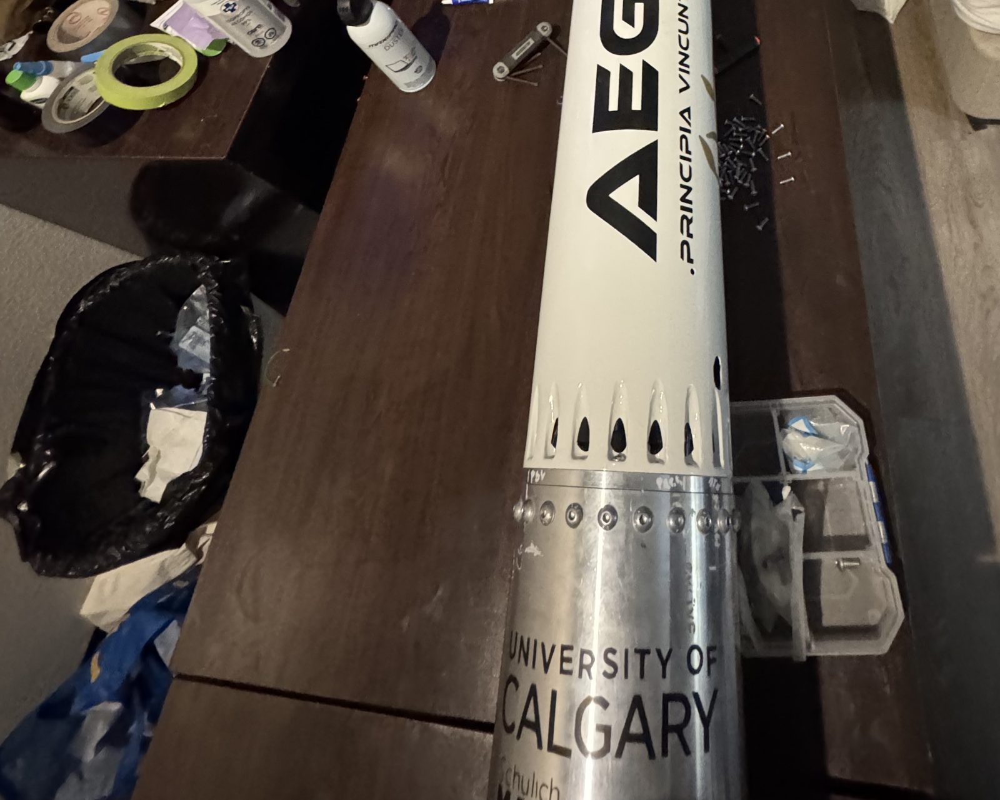

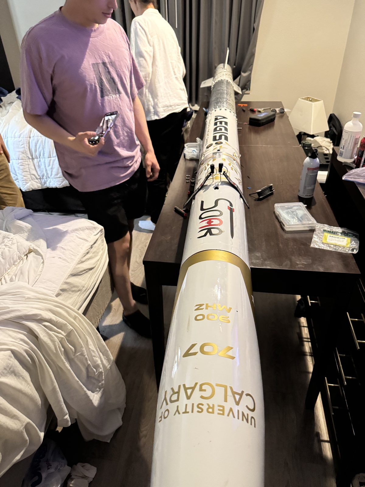 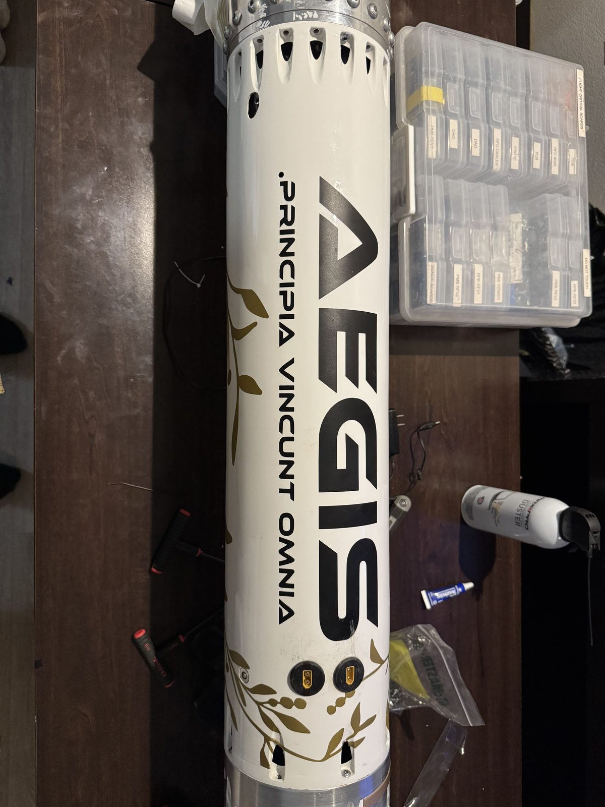

### On the field

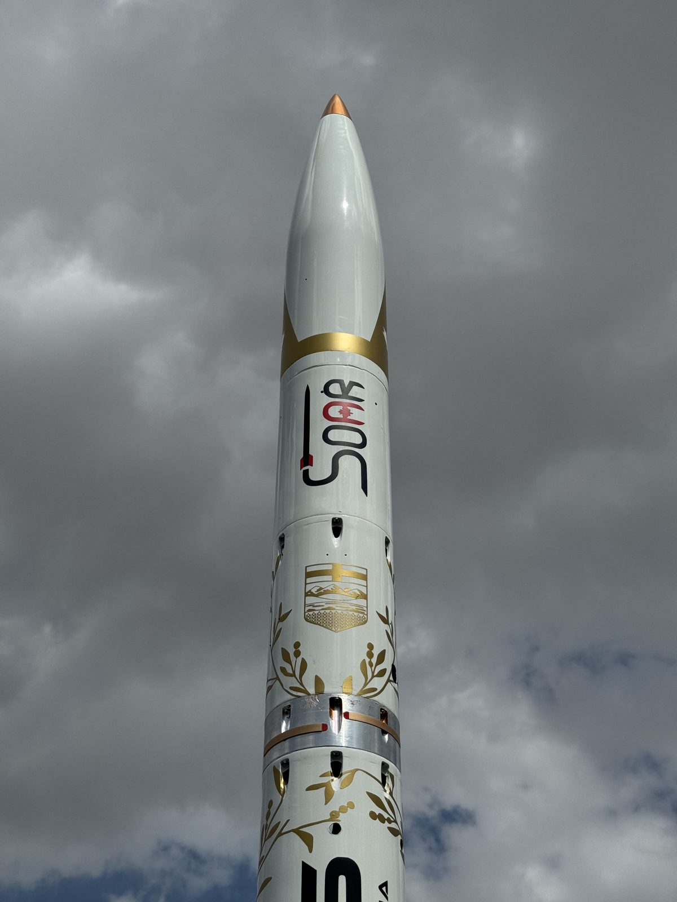 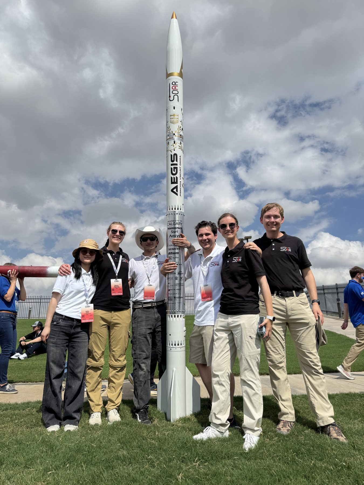

### On the rail

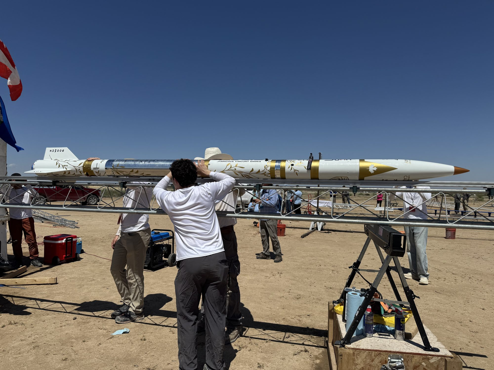

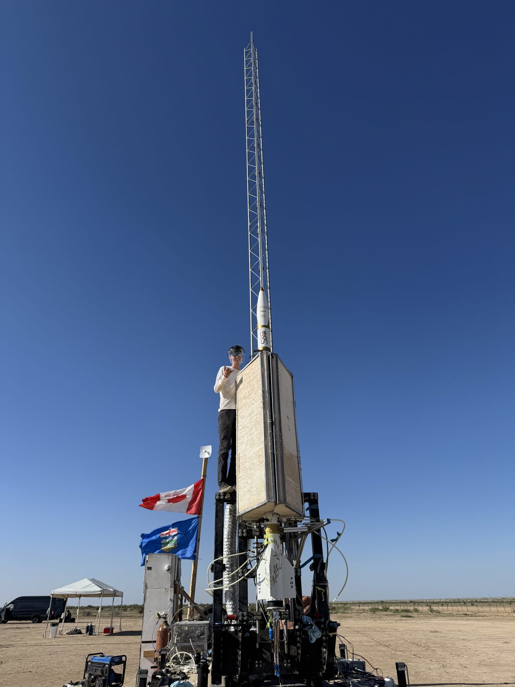 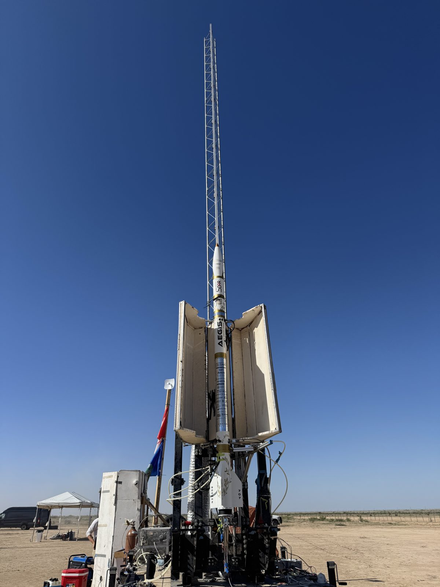

## The poster

The same visual language carried over to the team's poster: dark background, red accents from the SOAR mark, and a cutaway of the full rocket labelled by subsystem, with a panel for each major system underneath.

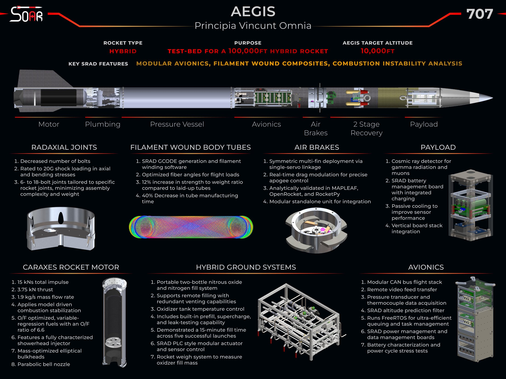

<!-- Idea for a closing section: what you'd do differently next time, e.g. planning the paint around the composite reveal earlier, or exporting the model with clean UVs instead of a triangulated STEP mesh. -->
