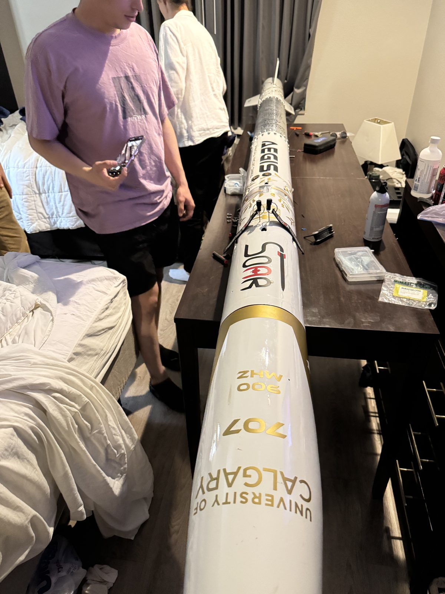
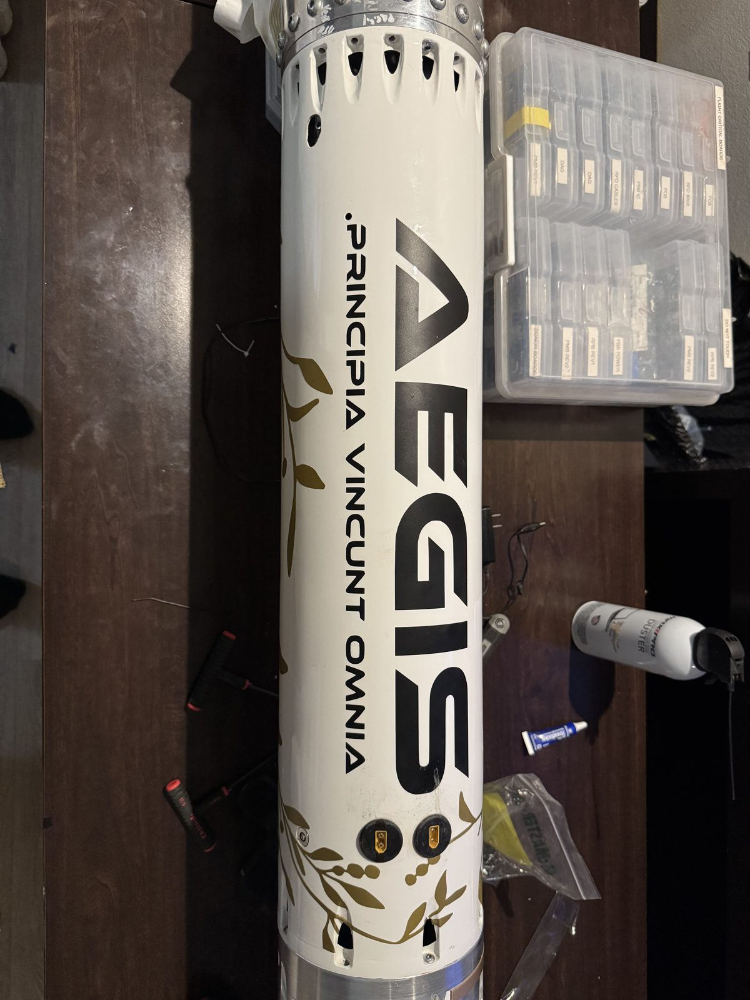

---
# ── Required ──────────────────────────────────────────────
title: "Example post: the blog format"
description: "A reference post showing every formatting feature the blog supports. Copy this folder to start a new post."
date: 2026-11-14

# ── Optional ──────────────────────────────────────────────
# updated: 2026-11-20        # shows "Updated …" under the date
tags: [reference]
experience: astropulse       # links the post to /experience/astropulse (astropulse | soar | garmin)
cover: ./cover.jpg           # image in this post's folder; used on the post and on cards
coverAlt: "Cutaway render of the AstroPulse Hall effect thruster"

# Documents section at the end of the post (PDFs open in a new tab, .pptx downloads).
# `file` is a path inside public/. Type and size are worked out automatically.
documents:
  - title: Aegis team poster
    file: documents/aegis/aegis-team-707-poster.pdf
    description: Optional one-line description under the title.

draft: false                  # true = never published, even when the blog is on
---

<!-- HTML comments like this one are notes to yourself: they are removed from the published page. -->

Opening paragraph. Write in plain Markdown; the site applies the theme (fonts,
colours, spacing, light and dark mode) automatically.

## Section heading

Every `##` heading is listed in the "On this page" menu beside the post on wide screens.
Headings are plain titles: no numbering needed.

Normal text, **bold**, *italic*, `inline code`, and [links](https://www.linkedin.com/in/shivam-desai-0458a5231/).

- Bullet lists
- work as usual

1. So do
2. numbered lists (the numbers show in the accent colour)

## Images

### Image with a caption

The text in quotes becomes the caption under the image. Images live next to
this file and are resized and compressed automatically.


### Smaller image

End the caption with `{width=…}` to shrink an image and centre it. Use a
percentage of the text column or a pixel width. Phones always show full width.


### Images side by side

Put two or three images on **one line**, separated by a space. They become one
row of equal tiles, good for tall phone photos. The captions are joined with " · ".

 

## Video

Put video files in `public/videos/` and link them like an image, starting with `/videos/`.

### Normal video (with play controls)

```md

```

### GIF-style loop (muted, autoplays, no controls)

Add `#loop` after the file name. Keep these short (a few seconds) and small (about 1 MB).


`{width=…}` works on videos too: `"Caption {width=60%}"`.

## Code

Add a language for syntax highlighting, and an optional file name:

```cpp title="hrm_driver.cpp"
void HrmDriver::init() {
    spi_.configure(SpiMode::Mode0, 8'000'000);
}
```

## Callouts

> [!NOTE]
> Extra context the reader might want.

> [!TIP]
> A useful shortcut.

> [!IMPORTANT]
> Something the reader must not miss.

> [!WARNING]
> Something that went wrong, or a gotcha.

> [!CAUTION]
> Something risky or destructive.

> Quotes without a `[!NOTE]`-style tag render as normal pull quotes.

## Equations

Inline: the exhaust velocity is $v_e = I_{sp} \, g_0$.

Block:

$$
T = \dot{m} \, v_e
$$

## Tables

| Parameter | Target |
|---|---|
| Thrust | 22 mN |
| Specific impulse | 1220 s |
| Power | 450 W |

## Added automatically

Reading time, the "On this page" menu, previous/next post links, and the
Documents section from the header above.
