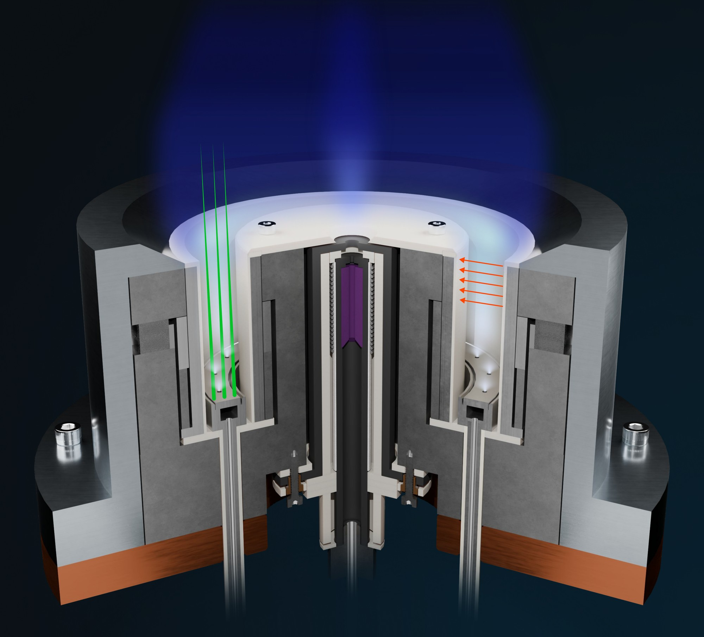

---
# ── Required ──────────────────────────────────────────────
title: "Example post: the blog format"
description: "A reference post showing every formatting feature the blog supports. Copy this folder to start a new post."
date: 2026-11-14

# ── Optional ──────────────────────────────────────────────
# updated: 2026-11-20        # shows "Updated …" under the date
tags: [reference]
experience: astropulse       # links the post to /experience/astropulse (astropulse | soar | garmin)
cover: ./cover.jpg           # image in this post's folder; used on the post and on cards
coverAlt: "Cutaway render of the AstroPulse Hall effect thruster"
draft: true                  # true = never published, even when the blog is on
---

Opening paragraph. Write in plain Markdown; the site applies the theme (fonts,
colours, spacing, light and dark mode) automatically.

## Section heading

Normal text, **bold**, *italic*, `inline code`, and [links](https://www.linkedin.com/in/shivam-desai-0458a5231/).

- Bullet lists
- work as usual

1. So do
2. numbered lists

### Images with captions

The text in quotes becomes the caption under the image. Images live next to
this file and are resized and compressed automatically.



### Code

Add a language for syntax highlighting, and an optional file name:

```cpp title="hrm_driver.cpp"
void HrmDriver::init() {
    spi_.configure(SpiMode::Mode0, 8'000'000);
}
```

### Callouts

> [!NOTE]
> Extra context the reader might want.

> [!TIP]
> A useful shortcut.

> [!WARNING]
> Something that went wrong, or a gotcha.

### Equations

Inline: the exhaust velocity is $v_e = I_{sp} \, g_0$.

Block:

$$
T = \dot{m} \, v_e
$$

### Tables

| Parameter | Target |
|---|---|
| Thrust | 22 mN |
| Specific impulse | 1220 s |
| Power | 450 W |

### Video

Put video files in `public/videos/` and link them like an image, starting with `/videos/`:

```md

```

> Quotes without a `[!NOTE]` tag render as normal pull quotes.
