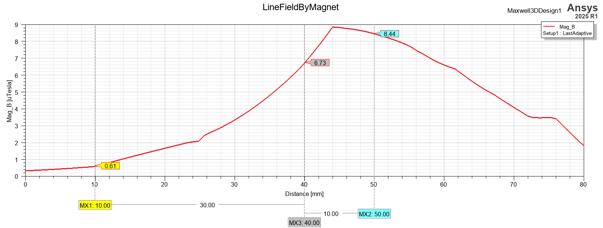
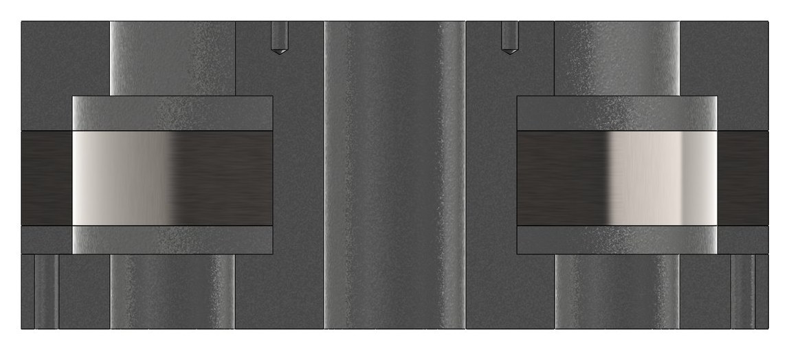
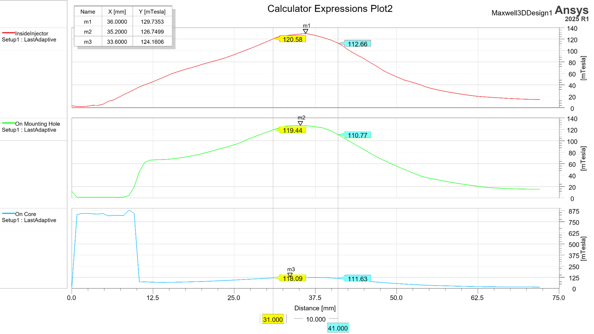
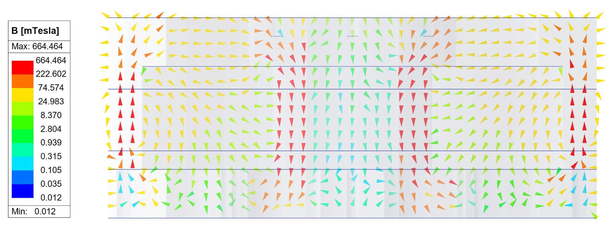
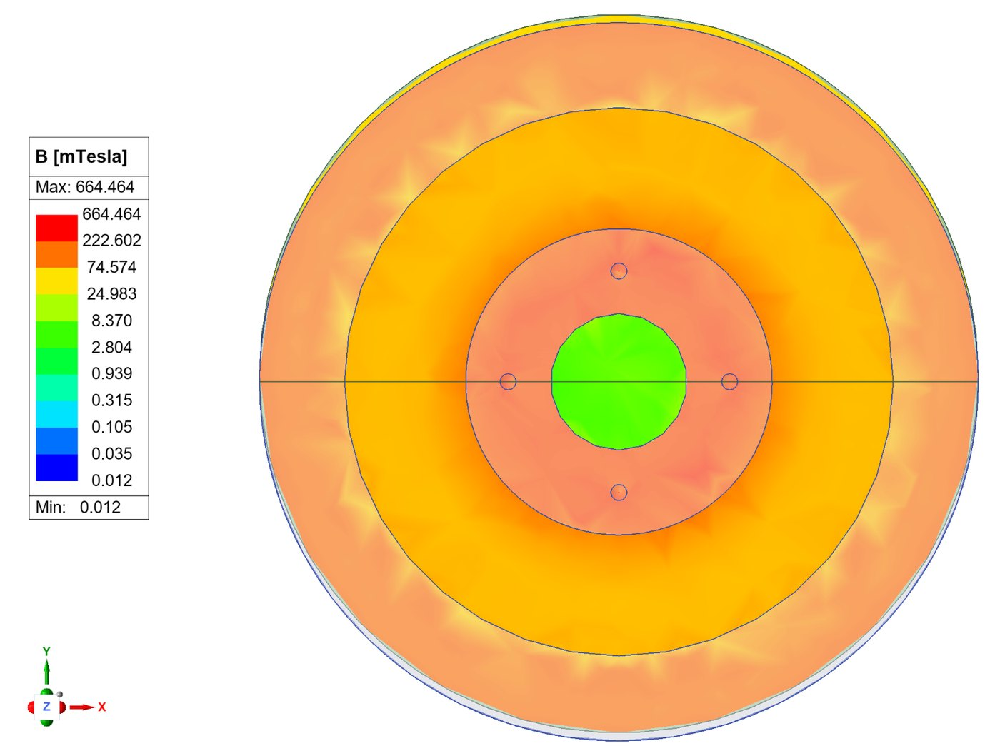
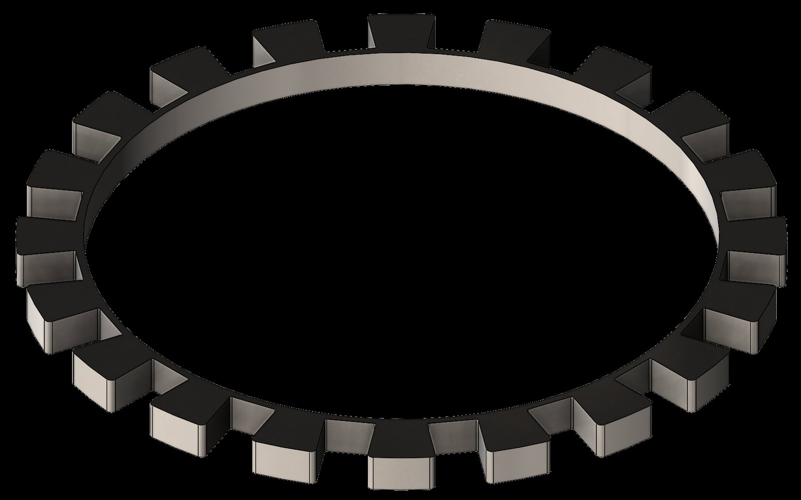
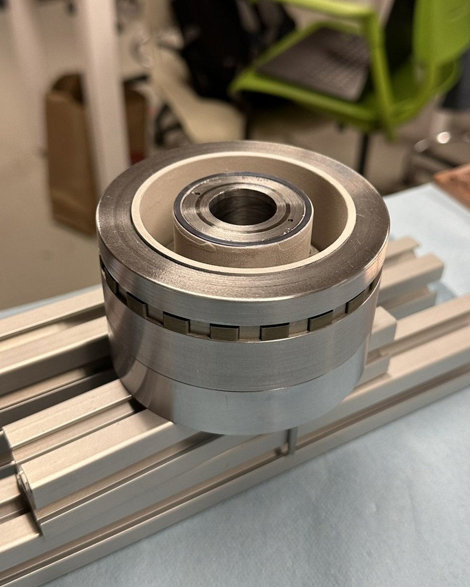
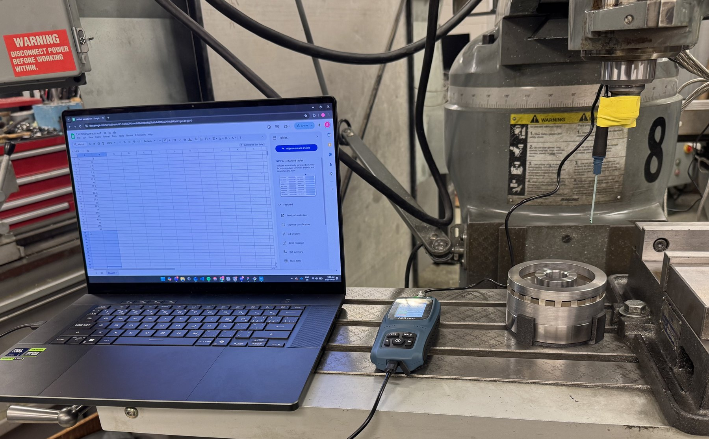

A Hall effect thruster only works if its magnetic field is right. The field has to trap electrons near the exit of the thruster channel so they ionise the propellant, while leaving the much heavier ions free to accelerate out and produce thrust. On AstroPulse I, I owned the design of the magnetic circuit that makes that field. This post walks through how we got from a target number to a measured field.

## What the field has to do

Electrons coming from the cathode spiral around magnetic field lines. The radius of that spiral, the Larmor radius, shrinks as the field gets stronger:

$$
r_e = \frac{1}{B}\sqrt{\frac{8\,m_e\,T_{eV}}{\pi e}}
$$

The ions follow the same idea:

$$
r_i = \frac{1}{B}\sqrt{\frac{2\,M\,V_b}{e}}
$$

But they're tens of thousands of times heavier, so their spiral is enormous. That gap is what a Hall thruster exploits. At our design field, the electron Larmor radius came out at about **0.34 mm** and the ion Larmor radius at about **439 mm**, against a channel length of **28.3 mm**. The electrons are trapped; the ions barely notice.

That left four requirements for the field itself:

1. **Radial.** It should cross the channel, so electrons drift around the channel instead of reaching the anode.
2. **Peaked at the exit plane.** Electrons should pile up just inside the exit, where they collide with neutral argon.
3. **Strong enough** to trap electrons.
4. **Weak enough** not to trap ions.

The size of the field came from scaling the SPT-100, a well-characterised flight thruster, down by a factor of two:

| Parameter | SPT-100 | AstroPulse I |
|---|---|---|
| Discharge power | 900 W | 450 W |
| Channel diameter | 100 mm | 70 mm |
| Channel width | 15 mm | 10.5 mm |
| Channel length | 40 mm | 28.3 mm |
| Magnetic field | 250 G | **353 G** |

## Coils or magnets?

Most Hall thrusters use electromagnetic coils. They're adjustable, but they draw power and generate heat, both of which hurt in a small, low-power thruster. We went the other way: a **ferromagnetic core** that steers the field from a set of small **permanent magnets** to exactly where we want it. No power, no heat. The trade-off is that the field strength is fixed once the magnets are in.

### Picking the materials

For the core we wanted high permeability and high saturation flux density. Specialty alloys like HiperCo 50 and Permalloy 49 are excellent on paper, but expensive and hard to get. **1018 low-carbon steel** has lower permeability, but it's cheap, easy to machine, and good enough.

For the magnets, temperature ruled out neodymium. Measurements on existing Hall thrusters put operating temperatures between roughly 210 °C and 365 °C, well past what NdFeB tolerates. **Samarium cobalt** keeps high remanence and coercivity at those temperatures, so it was the clear choice.

> [!NOTE]
> We also tried annealing small steel test cores, since annealing can raise the permeability of low-carbon steel. We measured no change in field strength at the poles, so the final core was left as machined.

## Iterating in ANSYS Maxwell

Before committing to magnet layouts, we checked that the basic core shape could do the job. The concept is an outer and inner steel pole with the discharge channel between them. Comparable, though not identical, geometries have been used in earlier research.

 and a cross-section (right)")

A magnetostatic study in Maxwell showed the radial field peaking at the exit plane and dropping off towards the anode, which is exactly the shape we needed.

From there it was many rounds of magnet size, position and count. The two main families were one large ring magnet, or many small bar magnets arranged in a ring.

 and a ring of small bar magnets (right)")

Rejected designs failed in one of two ways:

- **Too weak at the exit plane**, from magnets that were too small or too few.
- **Peaked inside the channel instead of at the exit.** Some placements, like ring magnets right at the exit plane, increased *fringing*: field lines spreading out across an air gap. More flux got pulled into the inner core, and the peak moved into the channel.

The final design uses **19 square ¼ in × ¼ in samarium cobalt magnets**, spaced evenly in a circle around the core. It produced a simulated peak of about **338 G**. Adding more magnets pushed it well past 353 G, so this was the right balance.

### Magnetic shielding

Flux that leaks out of the core can show up at the bottom of the channel, where we want the field as close to zero as possible. Two thin **1018 steel shielding rings** at the base of the channel catch that stray flux and redirect it back into the core.

## Building it

The magnet housing disk holds the magnets in position. Early on we didn't know how sensitive the field was to magnet placement, so we had the disk made by EDM, a precise and expensive process. We also tested a waterjet-cut version, and it performed about the same. The lesson: magnet placement didn't need to be nearly that precise. It was a useful result for keeping the thruster cheap to build.

We had also worried that the core parts would need surface grinding to get good contact with the magnets. In practice, light sanding, or no finishing at all, was enough.

## Measuring the field

To check the design, we mounted the thruster on a milling machine table and lowered a gauss meter probe into the discharge channel. The mill's handwheels gave precise, repeatable probe positions along the channel.

The measured peak was **335.2 G**, against a simulated **338.8 G**: about a 1% difference. The shape of the curve matched too, with the peak sitting right around the exit plane.

 and measured (green) field strength along the channel")

> [!TIP]
> If you need to map a field along an axis and don't have a motion stage, a manual mill is a surprisingly good one. Its handwheels give you repeatable positions to a few hundredths of a millimetre.

## What I'd take away

- **Permanent magnets and a steel core** are a great fit for small, low-power thrusters: zero power draw, zero heat, and a field you can shape with geometry.
- **Simulate the shape, then measure.** Maxwell got us within about 1% on peak field, but the real lessons (placement tolerance, surface finish, annealing) only came from building hardware.
- **Cheaper processes are often fine.** Waterjet instead of EDM, sanding instead of grinding. Testing early told us where precision actually mattered.
