<!-- DRAFT from the ICR and design report — Shivam to review. Check every image caption. -->

AstroPulse started as my idea: build a working Hall effect thruster, the kind of electric propulsion used on modern satellites, as an undergraduate capstone. I pitched it, put together a team of six, and led the project from concept to vacuum testing. Along the way we raised over $5,000 from sponsors, and AstroPulse won **gold in the multidisciplinary engineering category** at the Schulich Engineering Design Fair.

Because I came up with the idea and did the early research, I ended up owning the physics and the system design: setting the requirements for every subsystem and guiding how they fit together.

## How a Hall thruster works

A Hall effect thruster uses electric and magnetic fields instead of combustion. A radial magnetic field across an annular channel traps electrons from a cathode in a circular drift. Those trapped electrons collide with propellant atoms (argon, in our case) and ionise them, and an anode at a few hundred volts accelerates the ions out of the channel at around 30 km/s. That makes Hall thrusters far more efficient with propellant than chemical rockets, which is why they're used for orbit raising, station keeping and deorbiting.

## Concept and scaling

With Andrew, I researched existing Hall thruster designs and made the major architecture calls: a **centre-mounted cathode**, and **permanent magnets** instead of electromagnetic coils, for a lower-power, more efficient thruster.

I then scaled the design from the SPT-100, a well-characterised flight thruster, by a factor of two to fit our power and size budget. That set the baseline every subsystem designed to:

| Parameter | SPT-100 | AstroPulse I |
|---|---|---|
| Discharge power | 900 W | 450 W |
| Channel diameter | 100 mm | 70 mm |
| Channel length | 40 mm | 28.3 mm |
| Magnetic field | 250 G | 353 G |
| Thrust | 44.3 mN | 22 mN |
| Specific impulse | 1220 s | 1220 s |

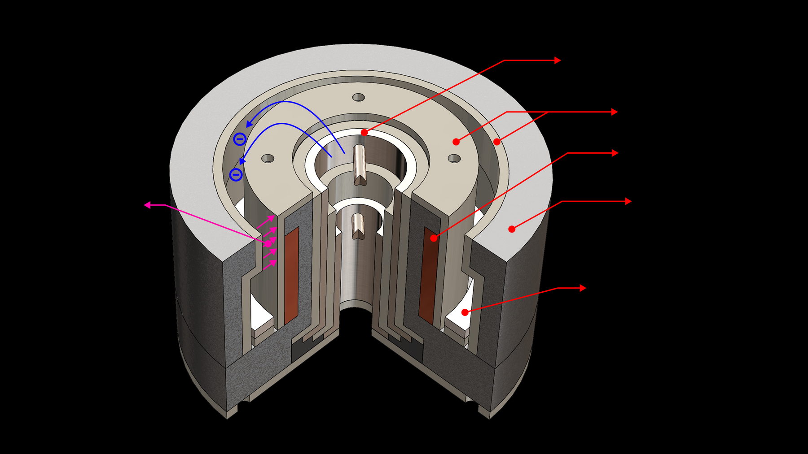

## Magnetic circuit

The magnetic field is what makes a Hall thruster work, and it was my main subsystem: research, concept, design iterations in ANSYS Maxwell, procurement, manufacturing and testing. The final design uses a 1018 steel core to steer the field from a ring of samarium cobalt magnets, peaking at the exit plane, with shielding rings to keep the field near zero at the anode.

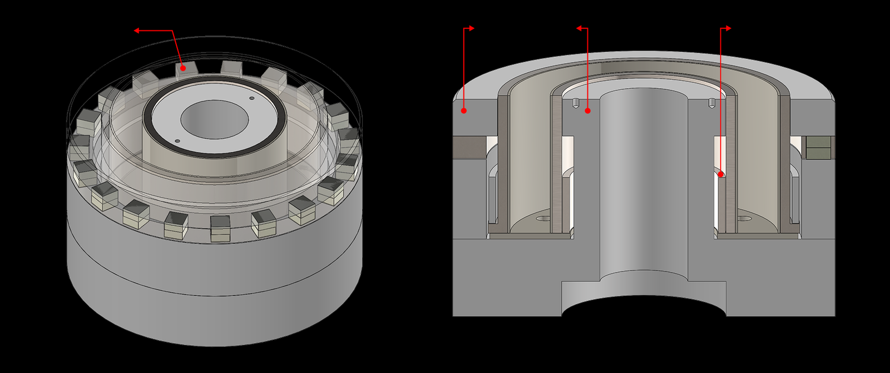

I validated it by mounting the core on a milling machine and stepping a gauss meter probe along the channel. The measured peak was **335.2 G against a simulated 338.8 G**, about 1% apart.

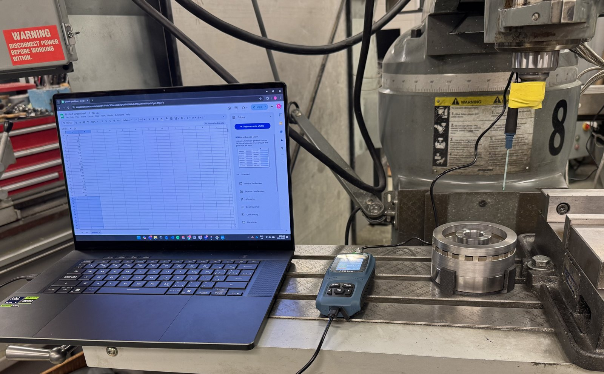

 vs measured (green) field along the channel")

## Channel walls, anode injector and cover

With the magnetics done, I took on the remaining thruster components to keep the project on schedule: materials selection, sourcing and design of the **alumina channel walls**, the **anode injector** (which also distributes propellant into the channel, and was brazed), and the **thruster cover** that holds the assembly together. Andrew helped with final edits to the anode injector for brazing.

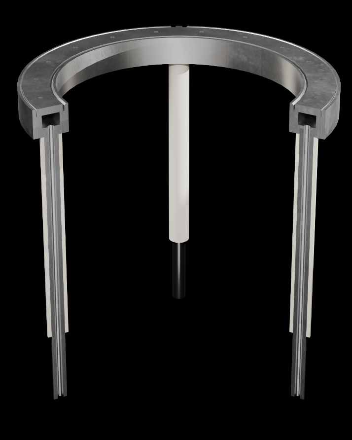

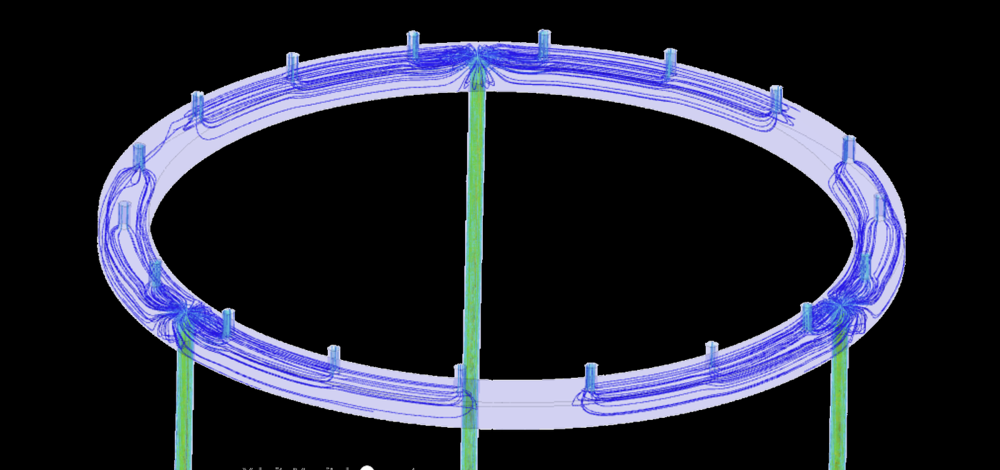

## Integration and thermal design

I integrated every thruster component in SolidWorks and used the full assembly to review the design and fix integration issues. After researching typical Hall thruster operating temperatures, I built a **system-level heat transfer model** in SolidWorks. Andrew and Zach Scott turned the results into a thermal-expansion spreadsheet, and Andrew and I used it to set clearances and tolerances for manufacturing.

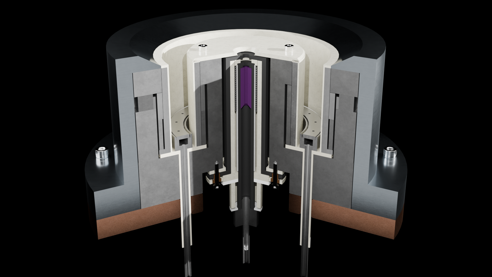

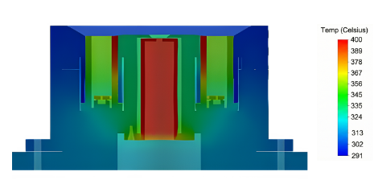

## Propellant feed system

Having worked on similar systems at SOAR, I laid out the piping and instrumentation diagram for the argon feed. Gavin completed the CAD and sourcing, and together we assembled the plumbing and leak tested it.

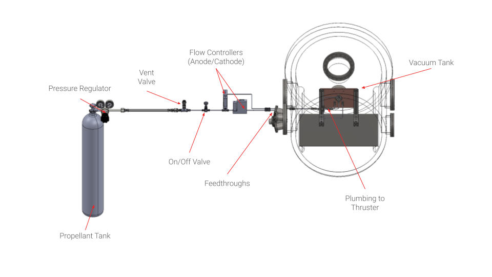

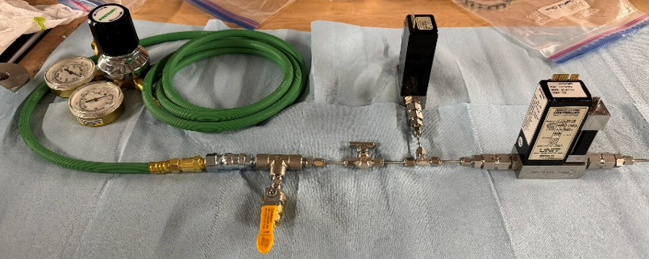

## Test stand

I designed the static test stand to hold the thruster steady in the vacuum chamber and meet vacuum requirements. Andrew designed the small tungsten mount at the front.

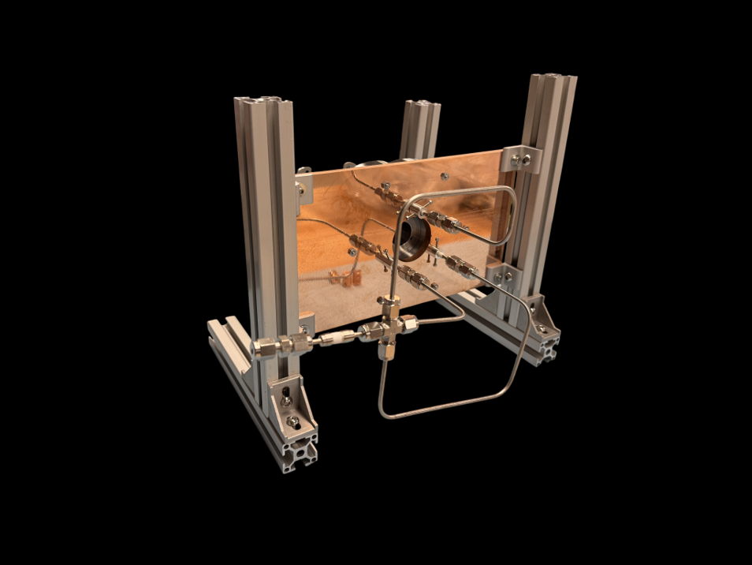

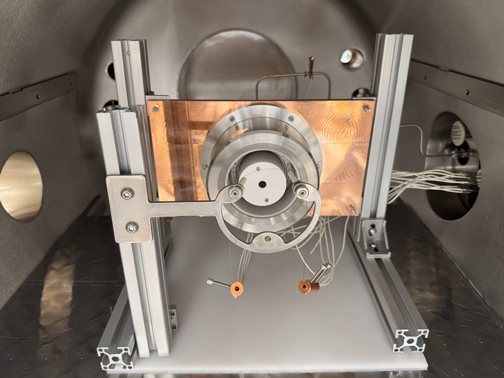

## Manufacturing and assembly

With Andrew, Zach Scott and Gavin, we machined every thruster component in house. My parts were the **stainless steel** and **1018 steel** components and **waterjet-cut alumina ceramics**. I then assembled the magnetic circuit, propellant system, thruster and test stand with Andrew and Gavin.

## Vacuum testing

The final stage was vacuum testing with the Department of Physics, working with their vacuum chamber, cryopumps and interfacing systems. I wrote our test procedures for review, sourced the power supplies we needed, and was at every setup, troubleshooting and test session.

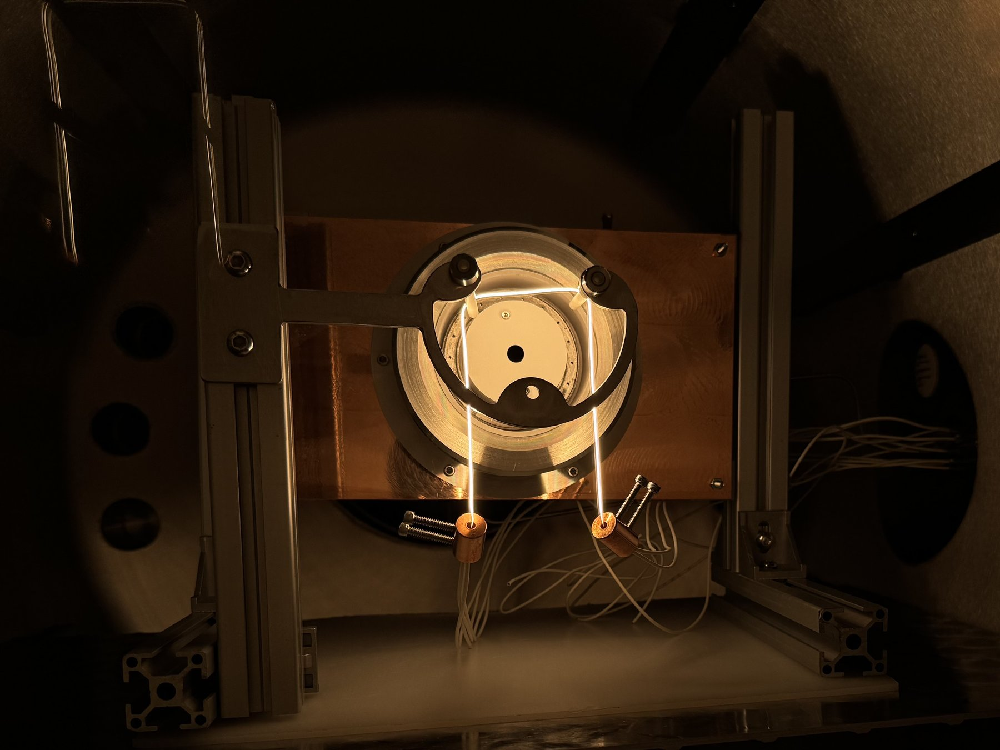

## The rest of the system

AstroPulse was a team effort across disciplines. Teammates designed the hollow cathode, the power electronics and an orbital mechanics simulator for software- and hardware-in-the-loop testing.

**Team:** Shivam Desai, Andrew Gonsalves, Gavin Angstadt, Zach Scott, Zachariah Blair and Gurnoor Gill.
